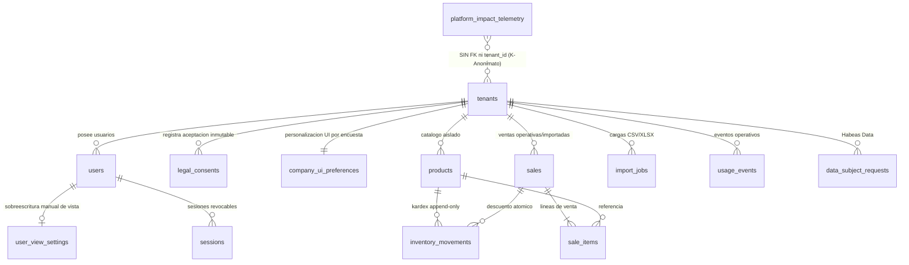

# PLANNING MAESTRO DE INGENIERÍA Y ORQUESTACIÓN (F-DC-124 -> F-DC-125)
## Proyecto: Datapyme Empresarial (MVP SaaS — Objetivo Específico 3)

**Institución:** Unidades Tecnológicas de Santander (UTS)  
**Formato Aprobado:** F-DC-124 (Propuesta de Trabajo de Grado — Modalidad Emprendimiento) hacia Informe Final F-DC-125  
**Alcance Funcional Obligatorio:** Objetivo Específico 3 — Fase 3 (Actividades 3.1 a 3.8)  
**Arquitectura de Orquestación:** Antigravity (Head Software Architect, Staff Security Engineer & Design Systems Lead) -> OpenCode (`opencode/deepseek-v4.1-flash-free --variant max`) -> Auditoría TDD (`pytest` + `ruff` + Playwright)  
**Ubicación del Producto Empresarial:** `empresarial/` (Aplicación SaaS Multi-Tenant aislada de `Datapyme Research Studio`)

---

## 1. HALLAZGOS DE LA INSPECCIÓN DEL ESPACIO DE TRABAJO Y ALINEACIÓN F-DC-124

### 1.1 Diagnóstico de la Inspección Técnica
1. **Separación Clara de Entregables (`Research Studio` vs. `Datapyme Empresarial`):**
   - El código previo del repositorio corresponde a **Datapyme Research Studio** (herramienta metodológica para el estudio de mercado del Objetivo 1, Business Model Canvas del Objetivo 2, registro de pruebas de validación y escenarios financieros del Objetivo 4).
   - Para dar cumplimiento estricto al **Objetivo Específico 3 (Actividades 3.1 a 3.8)** del formato **F-DC-124**, se construye en la carpeta dedicada `empresarial/` el **Prototipo Funcional Web (MVP SaaS)** para PyMEs del sector comercial de Bucaramanga.
2. **Estado de la Base de Datos de Investigación (`datapyme_local.db`):**
   - Las 8 empresas y 8 encuestas actualmente almacenadas en `datapyme_local.db` poseen la marca `[DEMO-FDC125]` generada por `research/demo_data.py` (0 entrevistas y 0 pruebas de prototipo reales registradas a la fecha).
   - Por rigor académico y ético (F-DC-124), dichos registros se tratan como **insumos de simulación para diseño** y no como evidencia empírica final hasta que concluya el trabajo de campo real.
3. **Verificación de Entorno y Herramientas:**
   - **Python 3.14.7** verificado localmente con soporte completo de paquetes binarios (*wheels*) para `fastapi`, `uvicorn`, `sqlalchemy`, `alembic`, `argon2-cffi`, `openpyxl`, `psycopg[binary]`, `pydantic`, `pytest`, `httpx`, `ruff` y `playwright`.
   - **OpenCode CLI `1.19.5`** operativo con soporte para `-m opencode/deepseek-v4.1-flash-free --variant max`.
   - **Stitch MCP** activo para generación de interfaces de alta fidelidad bajo los lineamientos de **Apple Human Interface Guidelines (HIG)** y la skill **Impeccable**.

### 1.2 Traducción de Variables del Estudio de Mercado (`M04–M24`) a Decisiones de UX/Producto

| Variable / Pregunta en Instrumento (`questions.py`) | Dolor o Necesidad Detectada en PyMEs Comerciales | Solución Arquitectónica y de UX en `empresarial/` |
| :--- | :--- | :--- |
| **`M05` Subsector Comercial** | Diversidad de giros en Bucaramanga: Alimentos y bebidas, Ropa/calzado, Belleza, Tecnología, Ferretería y hogar, Mayorista. | Campo `subsector` tipado en `tenants`, usado para valores por defecto de alertas de rotación y para telemetría agregada con $k$-anonimato. |
| **`M07` / `M08` / `M13` Madurez Digital** | Coexistencia de comercios con registros manuales/cuaderno, hojas de cálculo (Excel) y software POS/administrativo. | 1. **Importador Universal CSV/XLSX** tolerante a formatos colombianos (`1.234,50`). 2. **Densidad Visual Adaptativa (`preferred_chart_density`):** `simple` (para quienes vienen de cuaderno), `standard` (Excel) o `detailed` (software previo). |
| **`M10` Dolores Principales** | Diferencias en inventario, no identificar fácilmente la rotación, demora preparando informes, datos dispersos, dificultad para analizar ventas. | **Tarjetas de KPIs Expandidas** en la zona superior para los dolores específicos marcados por la empresa, más motor de conciliación de stock (`inventory_movements` append-only) y exportación en un clic. |
| **`M12` / `M17` Capacidad Prioritaria** | Heterogeneidad en la prioridad del comerciante: unos priorizan *Inventarios y existencias*, otros *Consulta de ventas e indicadores*, *Rotación* o *Tendencias/estimaciones*. | **Motor de Interfaz Adaptativa Basado en Encuesta (`ui_personalization_service.py`)** + **Bento Grid Adaptativo**: reordena dinámicamente la **Hero Bento Row** y el menú lateral según los pesos de la encuesta de cada PyME, con selector manual estilo Apple en la barra superior. |
| **`M15` / `M18` Barreras y Condiciones** | Precio accesible, facilidad de uso, tiempo de implementación corto, importación de datos y confidencialidad/seguridad. | Onboarding en 3 pasos (< 5 minutos), plantillas descargables con validación fila por fila, aislamiento multi-tenant estricto y panel de Habeas Data (*Mis datos*). |
| **`M24` (Línea Base de Reportes)** | Tiempo invertido antes de Datapyme en preparar informes manuales de ventas/inventario. | Alimenta `telemetry_baselines` para calcular con sustento metodológico el indicador `est_minutes_saved` en el informe F-DC-125. |

---

## 2. ARQUITECTURA MULTI-TENANT, MODELO DE DATOS Y TELEMETRÍA PRIVADA

### 2.1 Diagrama Entidad-Relación Multi-Tenant + Motor Adaptativo + Telemetría Desacoplada

### 2.2 Especificación Exacta de Tablas Relacionales (SQLAlchemy 2.x + Alembic)

#### 1. `tenants` (Empresas Clientes — PyMEs Comerciales)
- `id`: `UUID` (PK).
- `legal_name`: `String(180)` NOT NULL *(jamás expuesto en telemetría)*.
- `trade_name`: `String(180)` NULL.
- `nit`: `String(20)` NULL UNIQUE *(opcional; nunca se expone fuera del propio tenant)*.
- `subsector`: `Enum('alimentos_bebidas', 'ropa_calzado_accesorios', 'belleza_cuidado_personal', 'tecnologia_electronicos', 'ferreteria_hogar', 'mayorista_no_especializado', 'otro_comercial')` NOT NULL.
- `size`: `Enum('micro', 'pequena', 'mediana')` NOT NULL.
- `municipality`: `String(60)` NOT NULL DEFAULT `'Bucaramanga'`.
- `research_stats_opt_in`: `Boolean` NOT NULL DEFAULT `False` *(espejo derivado del último consentimiento `aggregate_stats_research` en `legal_consents`)*.
- `status`: `Enum('active', 'pending_deletion', 'anonymized')` NOT NULL DEFAULT `'active'`.
- `deletion_scheduled_at`: `DateTime(timezone=True)` NULL.
- `anonymized_at`: `DateTime(timezone=True)` NULL.
- `created_at`, `updated_at`: `DateTime(timezone=True)` NOT NULL.

#### 2. `users` (Usuarios y Roles con Control de Acceso)
- `id`: `UUID` (PK).
- `tenant_id`: `UUID` FK(`tenants.id`) NULL *(NULL exclusivamente cuando `role == 'superadmin'`; garantizado con `CheckConstraint("(role = 'superadmin' AND tenant_id IS NULL) OR (role != 'superadmin' AND tenant_id IS NOT NULL)")`)*.
- `email`: `String(254)` NOT NULL UNIQUE (normalizado en minúsculas).
- `full_name`: `String(120)` NOT NULL.
- `password_hash`: `String(255)` NOT NULL *(Hash Argon2id mediante `argon2-cffi`)*.
- `role`: `Enum('owner', 'manager', 'seller', 'warehouse', 'superadmin')` NOT NULL.
  - **Restricción Crítica:** El rol `superadmin` tiene acceso **exclusivo** a `/api/admin/impact` y recibe `403 Forbidden` en cualquier ruta de ventas, productos o inventarios de los tenants.
- `is_active`: `Boolean` NOT NULL DEFAULT `True`.
- `failed_logins`: `Integer` NOT NULL DEFAULT `0`.
- `locked_until`: `DateTime(timezone=True)` NULL.
- `password_changed_at`, `last_login_at`, `created_at`: `DateTime(timezone=True)`.

#### 3. `sessions` (Sesiones Revocables en Base de Datos)
- `id`: `UUID` (PK), `user_id`: `UUID` FK(`users.id`) NOT NULL, `token_hash`: `String(64)` UNIQUE NOT NULL (SHA-256), `csrf_secret`: `String(64)` NOT NULL, `expires_at`: `DateTime(timezone=True)` NOT NULL, `revoked_at`: `DateTime(timezone=True)` NULL, `ip_hash`: `String(64)` NOT NULL, `created_at`: `DateTime(timezone=True)` NOT NULL.

#### 4. `legal_consents` (Registro Inmutable de Consentimientos — Ley 1581 de 2012 y Decreto 1377 de 2013)
- `id`: `UUID` (PK).
- `tenant_id`: `UUID` FK(`tenants.id`) NOT NULL.
- `user_id`: `UUID` FK(`users.id`) NOT NULL.
- `document_type`: `Enum('data_policy', 'terms_mvp', 'aggregate_stats_research', 'survey_personalization_link')` NOT NULL.
- `document_version`: `String(20)` NOT NULL.
- `document_sha256`: `String(64)` NOT NULL *(hash exacto del texto legal presentado)*.
- `action`: `Enum('accept', 'revoke')` NOT NULL *(toda revocación inserta una nueva fila; prohibido `UPDATE` o `DELETE` mediante triggers de base de datos)*.
- `accepted_at`: `DateTime(timezone=True)` NOT NULL.
- `ip_hash`, `user_agent_hash`: `String(64)` NOT NULL.
- `prev_hash`, `row_hash`: `String(64)` NOT NULL *(cadena criptográfica SHA-256 por `tenant_id` para auditoría de integridad inmutable)*.

#### 5. `company_ui_preferences` (Motor de Interfaz Adaptativa Basado en Encuesta)
- `id`: `UUID` (PK).
- `tenant_id`: `UUID` FK(`tenants.id`) NOT NULL UNIQUE *(1:1 por empresa)*.
- `source`: `Enum('onboarding_quiz', 'survey_import')` NOT NULL.
- `diagnosis_answers`: `JSON` NOT NULL *(respuestas codificadas `M10`, `M12`, `M17`, `M07/M08`, `M13`, `M15`; cero datos personales)*.
- `mapping_version`: `String(20)` NOT NULL DEFAULT `'map-v1'`.
- `priority_weights`: `JSON` NOT NULL *(`{"weight_sales": float, "weight_inventory": float, "weight_predictive": float}`, suma = `1.000`)*.
- `weight_sales`: `Numeric(5, 3)` NOT NULL.
- `weight_inventory`: `Numeric(5, 3)` NOT NULL.
- `weight_predictive`: `Numeric(5, 3)` NOT NULL.
- `primary_focus`: `Enum('sales', 'inventory', 'predictive', 'balanced')` NOT NULL.
- `secondary_focus`: `Enum('sales', 'inventory', 'predictive')` NULL.
- `preferred_chart_density`: `Enum('simple', 'standard', 'detailed')` NOT NULL.
- `diagnosed_at`, `updated_at`: `DateTime(timezone=True)` NOT NULL.

#### 6. `user_view_settings` (Control Manual de Sobreescritura de Vista)
- `user_id`: `UUID` PK FK(`users.id`), `tenant_id`: `UUID` FK(`tenants.id`) NOT NULL, `view_mode`: `Enum('personalized', 'general')` NOT NULL DEFAULT `'personalized'`, `updated_at`: `DateTime(timezone=True)` NOT NULL.

#### 7. `products` (Catálogo de Productos y Stock Actual)
- `id`: `UUID` (PK), `tenant_id`: `UUID` FK(`tenants.id`) NOT NULL.
- `sku`: `String(64)` NOT NULL, `name`: `String(180)` NOT NULL, `category`: `String(90)` NOT NULL, `unit`: `String(20)` NOT NULL DEFAULT `'und'`.
- `cost_price`: `Numeric(14, 2)` NOT NULL (`>= 0`), `sale_price`: `Numeric(14, 2)` NOT NULL (`>= 0`), `vat_rate`: `Numeric(5, 2)` NOT NULL DEFAULT `19.00`.
- `stock_qty`: `Numeric(14, 3)` NOT NULL DEFAULT `0` *(actualizado atómicamente con `inventory_movements`)*, `min_stock`: `Numeric(14, 3)` NOT NULL DEFAULT `0`.
- `is_active`: `Boolean` NOT NULL DEFAULT `True`, `created_at`, `updated_at`: `DateTime(timezone=True)`.
- Restricciones: `UniqueConstraint('tenant_id', 'sku')`, `UniqueConstraint('tenant_id', 'id')` (para integridad referencial compuesta).

#### 8. `inventory_movements` (Kardex Inmutable de Movimientos de Inventario)
- `id`: `UUID` (PK), `tenant_id`: `UUID` NOT NULL, `product_id`: `UUID` NOT NULL.
- `movement_type`: `Enum('initial_load', 'purchase_in', 'sale_out', 'return_in', 'adjustment_in', 'adjustment_out')` NOT NULL.
- `quantity`: `Numeric(14, 3)` NOT NULL (`!= 0`; positivo para entradas, negativo para salidas).
- `unit_cost`: `Numeric(14, 2)` NULL, `reason`: `String(200)` NOT NULL, `sale_id`: `UUID` NULL, `import_job_id`: `UUID` NULL, `occurred_at`: `DateTime(timezone=True)` NOT NULL, `created_by`: `UUID` FK(`users.id`) NULL, `created_at`: `DateTime(timezone=True)` NOT NULL.
- Foreign Key compuesta: `ForeignKeyConstraint(['tenant_id', 'product_id'], ['products.tenant_id', 'products.id'])`.

#### 9. `sales` y `sale_items` (Transacciones Operativas e Históricas de Venta)
- **`sales`:** `id` (`UUID` PK), `tenant_id` (`UUID` NOT NULL), `sale_number` (`Integer` NOT NULL, único por `tenant_id`), `occurred_at` (`DateTime(timezone=True)` NOT NULL), `customer_label` (`String(80)` NULL, sin PII sensible), `payment_method` (`Enum('cash', 'card', 'transfer', 'credit', 'other')`, sin datos bancarios), `subtotal`, `discount_total`, `vat_total`, `total`, `cogs_total` (`Numeric(14, 2)` NOT NULL), `status` (`Enum('completed', 'voided')`), `source` (`Enum('manual', 'import')`), `import_job_id` (`UUID` NULL), `created_by` (`UUID` NULL), `created_at` (`DateTime(timezone=True)`).
- **`sale_items`:** `id` (`UUID` PK), `tenant_id` (`UUID` NOT NULL), `sale_id` (`UUID` NOT NULL), `product_id` (`UUID` NOT NULL), `quantity` (`Numeric(14, 3)` `> 0`), `unit_price`, `unit_cost_snapshot`, `vat_rate`, `discount`, `line_total` (`Numeric(14, 2)` NOT NULL). FKs compuestas hacia `sales(tenant_id, id)` y `products(tenant_id, id)`.

#### 10. `platform_impact_telemetry` (Telemetría Global Anonimizada para el Informe F-DC-125)
- **Aislamiento de Privacidad:** Tabla desacoplada **sin columna `tenant_id`**, sin FK a `tenants`, sin nombres comerciales, sin NITs y sin correos. Alimentada únicamente con tenants que hayan otorgado el consentimiento `aggregate_stats_research`.
- **Columnas:**
  - `id` (`UUID` PK), `snapshot_date` (`Date` NOT NULL), `scope` (`Enum('global', 'subsector')`), `subsector` (`String(40)` NULL), `k_threshold` (`Integer` NOT NULL DEFAULT `3`).
  - `active_tenants` (`Integer`), `sales_count` (`BigInteger`), `sales_amount_cop` (`Numeric(18, 0)` redondeado a miles de COP), `products_managed` (`BigInteger`).
  - `stockout_risk_alerts` (`BigInteger`), `alerts_resolved_in_time` (`BigInteger`), `overstock_flags` (`BigInteger`), `forecasts_generated` (`BigInteger`), `reports_generated` (`BigInteger`).
  - `est_minutes_saved` (`Numeric(14, 0)` NULL, calculado contra `telemetry_baselines`), `baseline_ref` (`String(120)` NULL).
  - `focus_sales_n`, `focus_inventory_n`, `focus_predictive_n`, `focus_balanced_n` (`Integer` NULL — distribución agregada de enfoques del motor adaptativo).
  - `is_suppressed` (`Boolean` NOT NULL — si `active_tenants < k_threshold`, las métricas detalladas se suprimen a `NULL` para impedir reidentificación).

---

## 3. MOTOR DE INTERFAZ ADAPTATIVA BASADO EN ENCUESTA (`ui_personalization_service.py`)

### 3.1 Matriz Determinista de Pesos (`map-v1`)

1. **Entradas (`DiagnosisInput`):**
   - Respuestas de la encuesta del Estudio de Mercado (`M10` dificultades, `M12` información más útil, `M17` capacidad prioritaria, `M07/M08` medios actuales de registro, `M13` uso de tableros, `M15` barreras) o las 3 preguntas equivalentes del Onboarding rápido.
2. **Asignación de Puntos por Eje (`sales`, `inventory`, `predictive`):**
   - `M10`: *Dificultad para analizar ventas* (`+1.0 sales`), *Demora preparando informes* (`+1.0 sales`), *Diferencias en inventario* (`+1.0 inventory`), *No identifica fácilmente la rotación* (`+1.0 inventory`), *Datos dispersos* (`+0.5 sales`, `+0.5 inventory`), *Información desactualizada* (`+0.5 sales`, `+0.5 inventory`).
   - `M12`: *Ventas por periodo* (`+1.0 sales`), *Comparación entre periodos* (`+1.0 sales`), *Productos más y menos vendidos* (`+1.0 sales`), *Existencias y alertas* (`+1.0 inventory`), *Rotación de productos* (`+1.0 inventory`), *Tendencias o estimaciones* (`+1.0 predictive`).
   - `M17` (Prioridad declarada — doble peso): *Consulta de ventas e indicadores* (`+2.0 sales`), *Inventarios y existencias* (`+2.0 inventory`), *Rotación de productos* (`+2.0 inventory`), *Tendencias o estimaciones* (`+2.0 predictive`).
3. **Normalización Suavizada (Laplace $\alpha = 0.5$):**
   $$w_i = \text{round}\left(\frac{P_i + 0.5}{(P_{\text{sales}} + P_{\text{inventory}} + P_{\text{predictive}}) + 1.5},\ 3\right)$$
   *(El componente mayoritario absorbe la diferencia de milésimas para garantizar $\sum w_i = 1.000$ exacto)*.
4. **Regla de `primary_focus` y `secondary_focus`:**
   - Sea $w_{(1)} \ge w_{(2)} \ge w_{(3)}$ (con desempate determinista `inventory` > `sales` > `predictive`).
   - Si $w_{(1)} \ge 0.40$ y $(w_{(1)} - w_{(2)}) \ge 0.15$, entonces `primary_focus` es el eje de $w_{(1)}$; de lo contrario es `'balanced'`.
   - Si $w_{(2)} \ge 0.15$ y `primary_focus != 'balanced'`, entonces `secondary_focus` es el eje de $w_{(2)}$; de lo contrario `None`.
5. **Regla de Densidad Visual (`preferred_chart_density`):**
   - Nivel base según `M07/M08` (o pregunta 3 del onboarding):
     - Solo *Registros manuales* / *No hay registro organizado* -> nivel `0` (`simple`).
     - *Hojas de cálculo* -> nivel `1` (`standard`).
     - *Facturación / punto de venta*, *Software de inventarios* o *Software administrativo / ERP* -> nivel `2` (`detailed`).
   - Modificadores: si `M13 == 'Sí'` (`+1`); si marca *Herramientas costosas o complejas* en `M10` o *Falta de conocimientos tecnológicos* en `M15` (`-1`).
   - Se acota al rango `[0, 2]` -> `{0: 'simple', 1: 'standard', 2: 'detailed'}`.

### 3.2 Contrato de Salida `layout_config` (`layout-v1`)

| `primary_focus` | `hero_row` (12 columnas totales) | `expanded_kpis` (Zona Superior) | `compact_kpis` (Zona Inferior) | `nav_order` (Menú Lateral) |
| :--- | :--- | :--- | :--- | :--- |
| **`inventory`** | `stock_alerts` (`xl`: 8 col) + `turnover_coverage` (`m`: 4 col) | `['stockout_risk', 'turnover', 'overstock']` | `['revenue', 'gross_margin', 'avg_ticket']` | `['home', 'inventory', 'sales', 'forecast', 'my_data']` |
| **`sales`** | `sales_trend` (`xl`: 8 col) + `top_products` (`m`: 4 col) | `['revenue', 'gross_margin', 'avg_ticket']` | `['stockout_risk', 'turnover', 'overstock']` | `['home', 'sales', 'inventory', 'forecast', 'my_data']` |
| **`predictive`** | `forecast_main` (`xl`: 8 col, **con aviso metodológico F-DC-124 fijo**) + `sales_trend` (`m`: 4 col) | `['forecast_next_period', 'revenue', 'stockout_risk']` | `['gross_margin', 'avg_ticket', 'turnover']` | `['home', 'forecast', 'sales', 'inventory', 'my_data']` |
| **`balanced`** *(o `view_mode='general'`)* | `sales_trend` (`l`: 6 col) + `stock_alerts` (`l`: 6 col) | `['revenue', 'gross_margin', 'stockout_risk', 'turnover']` | `['avg_ticket', 'overstock']` | `['home', 'sales', 'inventory', 'forecast', 'my_data']` |

**Invariante de Completitud:** El conjunto total de widgets (`stock_alerts`, `turnover_coverage`, `sales_trend`, `top_products`, `category_mix`, `forecast_teaser`/`forecast_main`) y el conjunto total de los 6 KPIs están **siempre presentes** en el DOM; jamás se suprime funcionalidad a ninguna empresa.

---

## 4. SISTEMA DE DISEÑO UI/UX (APPLE HIG + IMPECCABLE + STITCH)

### 4.1 Tokens Visuales (`empresarial/design/tokens.json` -> `static/css/tokens.css`)
- **Paleta OKLCH Libre de "AI Slop":**
  - Superficie base (60 %): `--surface-canvas: oklch(98.5% 0.003 250)` (`#F8FAFC` tintado frío sutil, nunca `#FFFFFF` puro en el lienzo).
  - Tarjetas y paneles (30 %): `--surface-card: #FFFFFF` con borde ultra sutil `--border-subtle: 1px solid rgba(15, 23, 42, 0.06)` y sombra multicapa `--shadow-apple: 0 1px 2px rgba(15,23,42,0.03), 0 4px 12px rgba(15,23,42,0.04)`.
  - Superficie traslúcida en barra superior (`topbar`): `background: rgba(255, 255, 255, 0.78); backdrop-filter: blur(12px) saturate(180%)`.
  - Acento corporativo (10 %): `--accent-primary: oklch(52% 0.11 192)` (`#0D7A6F` Teal Ejecutivo de alto contraste WCAG AA) y estados semánticos (`--status-ok`, `--status-warn`, `--status-danger`).
- **Tipografía y Precisión Contable:**
  - Pila tipográfica: `'Inter', -apple-system, BlinkMacSystemFont, 'SF Pro Display', system-ui, sans-serif`.
  - Escala modular 1.25 (`12px`, `14px`, `16px`, `20px`, `24px`, `32px`, `40px`).
  - **Regla Inquebrantable:** `font-variant-numeric: tabular-nums` obligatorio en toda cifra en pesos colombianos (COP), porcentajes, $R^2$ y conteos de inventario.
  - **Cero Emojis:** Prohibido el uso de caracteres emoji Unicode en plantillas HTML, JS o respuestas de API (validado por `test_no_emoji.py`). Exclusivamente iconos vectoriales Lucide (`stroke-width: 1.75`).

### 4.2 Estructura de las 6 Pantallas Principales y Flujo Stitch
1. **Pantalla 1 — Acceso, Onboarding Legal (Ley 1581) y Diagnóstico Rápido UI:** Login seguro + paso de aceptación granular de política/términos y casilla opcional de telemetría agregada + paso de 3 preguntas de diagnóstico (o token de encuesta) que calcula en vivo su perfil adaptativo.
2. **Pantalla 2 — Dashboard Ejecutivo en Bento Grid Adaptativo:** Barra superior con píldora interactiva estilo Apple (*"Vista personalizada según tu diagnóstico: Prioridad [Foco] · [Cambiar vista]"*), **Hero Bento Row** dinámica, **KPIs Expandidos** arriba y **KPIs Compactos** + widgets secundarios abajo.
3. **Pantalla 3 — Gestión Operativa e Importación de Ventas:** Tabla tabular con filtros, panel de registro rápido con descuento atómico de stock e importador CSV/XLSX con previsualización de errores fila por fila.
4. **Pantalla 4 — Gestión de Inventarios, Kardex y Alertas de Stock:** Catálogo con semáforo accesible (icono + texto), cobertura en días, registro de entradas/ajustes con motivo obligatorio e importación masiva.
5. **Pantalla 5 — Analítica Predictiva Básica Transparente (OLS y SMA/WMA):** Serie histórica + proyección punteada a 1–3 periodos, selector de algoritmo (`OLS`, `SMA-3`, `WMA-3`), tarjeta matemática con ecuación explícita $\hat{y} = \beta_0 + \beta_1 x$, coeficiente de determinación $R^2$ y **Aviso Metodológico F-DC-124 fijo y no ocultable**.
6. **Pantalla 6 — Panel SuperAdmin de Telemetría e Impacto Agregado (F-DC-125):** Exclusivo para investigadores (`superadmin`), muestra sumatorias anonimizadas con $k$-anonimato ($k \ge 3$), distribución de enfoques adaptativos y tiempo estimado ahorrado frente a la línea base.

---

## 5. HOJA DE RUTA DE ORQUESTACIÓN POR SPRINTS (ANTIGRAVITY + OPENCODE + PYTEST)

### SPRINT 0: Fundaciones, Sistema de Diseño en Stitch y Esqueleto Base (Act. 3.1, 3.2)
- **Antigravity (Orquestador):**
  1. Crea la estructura `empresarial/`, `PLANNING_ORQUESTADOR_F-DC-124.md`, `docs/ALCANCE_F-DC-124.md`, `design/DESIGN.md` y `design/tokens.json`.
  2. Invoca **Stitch MCP** (`create_project`, `create_design_system`, `update_design_system`, `generate_screen_from_text`) para establecer el sistema de diseño Apple HIG + Impeccable y las vistas de referencia del Bento Grid Adaptativo.
  3. Configura `.venv` con Python 3.14, instala dependencias y redacta la suite inicial de pruebas (`tests/unit/test_health.py`, `tests/security/test_headers_csp.py`, `tests/unit/test_no_emoji.py`, `tests/unit/test_tokens_contrast.py`).
- **OpenCode (`opencode/deepseek-v4.1-flash-free --variant max`):**
  - *Prompt S0-01:* Construir la fábrica ASGI `app/main.py` (`create_app`), configuración `app/core/config.py`, cabeceras de seguridad CSP/HSTS/X-Frame-Options, hoja de estilos `static/css/tokens.css` y `.bento-grid`, y plantilla maestra `templates/base.html` libre de emojis.
- **Criterio de Aprobación (`pytest`):** 100 % de tests de Sprint 0 en verde + `ruff check` limpio.

### SPRINT 1: Núcleo Multi-Tenant, Autenticación Argon2id, Blindaje Legal y Motor Adaptativo `ui_personalization_service.py` (Act. 3.2)
- **Antigravity (Orquestador):**
  1. Define el esquema relacional y migración inicial (`tenants`, `users`, `sessions`, `legal_consents` con triggers de inmutabilidad y hash chain SHA-256, `company_ui_preferences`, `user_view_settings`, `survey_link_tokens`, `audit_logs`, `data_subject_requests`).
  2. Escribe primero (TDD) las suites:
     - `tests/unit/test_ui_personalization.py` (valida Casos de Oro: Empresa A enfocada en quiebres de inventario vs. Empresa B enfocada en crecimiento de ventas, invariante de completitud, densidad `simple`/`standard`/`detailed` y sobreescritura manual `personalized` vs `general`).
     - `tests/security/test_auth_argon2.py`, `tests/security/test_legal_consents_immutable.py`, `tests/security/test_tenant_isolation.py` y `tests/integration/test_onboarding_legal_flow.py`.
- **OpenCode (`opencode/deepseek-v4.1-flash-free --variant max`):**
  - *Prompt S1-01:* Implementar modelos SQLAlchemy, triggers SQLite/PostgreSQL de inmutabilidad en `legal_consents`, seguridad Argon2id, sesiones revocables, protección CSRF, Rate Limiting y repositorio base con `TenantContext` obligatorio.
  - *Prompt S1-02:* Programar `app/ui/ui_personalization_service.py` (`compute_priority_weights`, `build_layout_config`, `save_or_update_preferences`, `set_user_view_mode`), los endpoints `/api/ui/diagnosis`, `/api/ui/diagnosis/import`, `/api/ui/layout`, `/api/ui/view-mode`, las rutas de autenticación/onboarding y las vistas Jinja2 de Login, Onboarding Legal + Diagnóstico de 3 preguntas y previsualización del Bento Grid Adaptativo con el selector estilo Apple en la barra superior.
- **Criterio de Aprobación (`pytest`):** 100 % de la suite de unidad, seguridad e integración de Sprint 1 en verde.

### SPRINT 2: Gestión e Integración de Ventas e Inventarios + Carga Masiva CSV/XLSX (Act. 3.3)
- **Antigravity (Orquestador):**
  1. Define modelos y migración para `products`, `inventory_movements`, `sales`, `sale_items`, `import_jobs` y `usage_events` con claves foráneas compuestas `(tenant_id, id)`.
  2. Genera en Stitch las pantallas 3 (Ventas) y 4 (Inventarios) y escribe los tests de descuento atómico de stock, concurrencia, sanitización de archivos CSV/XLSX y aislamiento cruzado entre PyME A y PyME B.
- **OpenCode (`opencode/deepseek-v4.1-flash-free --variant max`):**
  - *Prompt S2-01:* Implementar servicios y endpoints de catálogo, kardex `inventory_movements`, registro atómico de ventas con cálculo de `cogs_total`, alertas de stock e importador transaccional CSV/XLSX con neutralización de fórmulas.
- **Criterio de Aprobación (`pytest`):** `test_sale_atomic_stock.py`, `test_inventory_reconciliation.py`, `test_upload_sanitization.py`, `test_tenant_isolation.py` al 100 %.

### SPRINT 3: Motor de KPIs Comerciales y Dashboard en Bento Grid Adaptativo (Act. 3.4)
- **Antigravity (Orquestador):**
  1. Especifica contratos matemáticos en `Decimal` para ingresos netos, margen bruto, ticket promedio, rotación de inventario, cobertura en días y clasificación Pareto de productos estrella vs. estancados.
  2. Escribe `tests/unit/test_kpis_math.py` y `tests/integration/test_bento_adaptive_rendering.py`.
- **OpenCode (`opencode/deepseek-v4.1-flash-free --variant max`):**
  - *Prompt S3-01:* Implementar `app/analytics/kpis.py`, endpoint `/api/kpis` y conectar las macros Jinja2 del Dashboard en Bento Grid Adaptativo con Chart.js local y el selector de vista superior.
- **Criterio de Aprobación (`pytest`):** Exactitud matemática al 100 % y renderizado diferenciado del Bento Grid entre Empresa A y Empresa B.

### SPRINT 4: Analítica Predictiva Básica Transparente — OLS y Promedios Móviles (Act. 3.5)
- **Antigravity (Orquestador):**
  1. Fija la Prueba de Oro matemática para Regresión Lineal Simple OLS ($\hat{y} = \beta_0 + \beta_1 x, R^2$) y Promedios Móviles (`SMA-3`, `WMA-3`) en Python puro (cero APIs externas de IA, cero modelos opacos).
  2. Genera en Stitch la Pantalla 5 y escribe `test_ols_golden.py`, `test_sma_wma.py`, `test_forecast_disclaimer_present.py` y `test_no_ai_dependencies.py`.
- **OpenCode (`opencode/deepseek-v4.1-flash-free --variant max`):**
  - *Prompt S4-01:* Implementar `app/forecast/stats.py`, endpoint `/api/forecast` y vista interactiva con ecuación explícita, $R^2$ y aviso metodológico obligatorio.
- **Criterio de Aprobación (`pytest`):** Tolerancia $< 10^{-9}$ en $R^2$, aviso ético presente en API y DOM, cero dependencias prohibidas.

### SPRINT 5: Telemetría de Impacto Anonimizada (`platform_impact_telemetry`) y Habeas Data (Act. 3.6, 3.7)
- **Antigravity (Orquestador):**
  1. Especifica el agregador con $k$-anonimato ($k = 3$), supresión complementaria y bloqueo estricto de datos individuales al `superadmin`.
  2. Escribe `test_telemetry_privacy.py`, `test_telemetry_k_anonymity.py`, `test_superadmin_cannot_read_tenant_data.py`, `test_habeas_data_export.py` y `test_account_deletion_flow.py`.
- **OpenCode (`opencode/deepseek-v4.1-flash-free --variant max`):**
  - *Prompt S5-01:* Implementar agregador de telemetría, Pantalla 6 (`SuperAdmin`), exportación total ZIP de datos del titular y flujo de solicitud de eliminación/anonimización con periodo de gracia.
- **Criterio de Aprobación (`pytest`):** Cero filtraciones de PII/NIT en telemetría y `403` para `superadmin` en rutas operativas.

### SPRINT 6: Pruebas E2E Playwright, Semilla Demo Contrastante y Preparación de Despliegue en Oracle Cloud (Act. 3.6, 3.7, 3.8)
- **Antigravity + OpenCode:**
  - Comando `seed-demo` / `clear-demo` con dos PyMEs sintéticas de Bucaramanga (Ferretería enfocada en Inventarios vs. Boutique enfocada en Ventas) para demostración en vivo del Bento Grid Adaptativo, suite E2E Playwright y artefactos `deploy/` para Oracle Cloud (`docker-compose.yml` multi-arch ARM64, PostgreSQL con RLS y proxy HTTPS).
