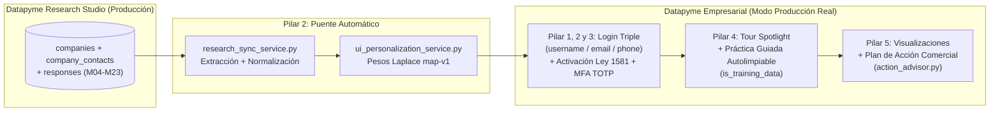

# PLANNING MAESTRO DE PRODUCCIÓN FINAL — DATAPYME EMPRESARIAL (F-DC-124 / F-DC-125)

**Rol:** Arquitecto Principal (Gemini 4 Argón — Staff Security, Data & Design Systems Lead)  
**Estado:** Fase Exclusiva de Planning (0 modificaciones en código fuente · 0 procesos en segundo plano)  
**Ecosistema auditado:** `Datapyme Research Studio` (raíz) + `Datapyme Empresarial` ([empresarial/](file:///h:/Antigravity%20Proyectos/Datapyme/empresarial)) + Servidor de Producción Oracle Cloud (`150.136.74.164`)

---

## Goal Description

Transformar `Datapyme Empresarial` de prototipo de validación a **Producto Final en Modo Producción Real** listo para entregar a las **13 PyMEs reales de Bucaramanga** que completaron el instrumento de mercado (`M04–M23`) en `Datapyme Research Studio` (incluyendo **VaFel Sweet** bajo control directo del equipo investigador), cumpliendo el 100 % de los compromisos metodológicos y éticos del formato aprobado **F-DC-124 (Objetivo Específico 3: Actividades 3.1 a 3.8)** y los estándares visuales **Impeccable (`distill`, `layout`, `onboard`, `clarify`, `harden`, `polish`) + Apple HIG**.



---

## User Review Required

> [!IMPORTANT]
> **Hallazgo Clave en la Base de Datos de Producción (`Research Studio`):**  
> Al inspeccionar en modo solo lectura el contenedor productivo `datapyme_app` en Oracle Cloud (`150.136.74.164`), identificamos **13 empresas reales con encuesta de mercado completada (`status='complete'`)** y **2 registros sin encuesta válida** (`id=1 Calzado Bucaramanga` sin respuestas ni contacto, e `id=18 fghjkl` registro de prueba con teléfono inválido `8232225`).  
> - En 12 de las 13 empresas reales, el campo `company_contacts.detail` contiene el **número de celular de 10 dígitos** (ej. `VaFel Sweet` -> `3052621817`) y en 1 contiene correo electrónico (`My Dulce Encanto` -> `Velascobrandon1908@gmail.com`).  
> - Por ello, el **Login Triple (`username`, `email`, `phone`)** del Pilar 2 resuelve de raíz el ingreso real: cada comerciante podrá entrar con su **usuario corto** (ej. `vafelsweet`), su **celular de 10 dígitos** (`3052621817`) o su **correo electrónico**.

> [!WARNING]
> **Inmutabilidad del Kardex vs. Borrado de Datos de Entrenamiento (`is_training_data`):**  
> Actualmente [models.py](file:///h:/Antigravity%20Proyectos/Datapyme/empresarial/app/core/models.py#L375-L424) instala triggers en SQLite y PostgreSQL (`trg_inventory_movements_no_delete` / `trg_pg_inventory_movements_immutable`) que bloquean cualquier `DELETE` en `inventory_movements`. Para que el botón **"Borrar producto y venta de prueba (Empezar mi cuenta 100% en limpio)"** del Pilar 4 funcione sin requerir permisos de superusuario en PostgreSQL ni romper la auditoría contable, el trigger se actualizará con cláusula condicional (`WHEN OLD.is_training_data = 0` en SQLite y `IF OLD.is_training_data IS TRUE THEN RETURN OLD; END IF;` en PostgreSQL), garantizando que **los movimientos reales jamás puedan borrarse** mientras que los registros marcados con `is_training_data = True` se limpien atómicamente.

---

## Open Questions

> [!NOTE]
> El alcance de los 7 pilares está completamente especificado en tu solicitud. Solo confirma al aprobar el plan si estás de acuerdo con estas 2 decisiones por defecto:
> 1. **Filtro de sincronización de empresas reales:** Sincronizar automáticamente las **13 empresas con encuesta `mercado` completada** (excluyendo el registro basura `fghjkl` y las demos `[DEMO-FDC125]`), dejando **VaFel Sweet** (`username: vafelsweet`, celular `3052621817`) aprovisionada y lista como cuenta empresarial propia del equipo.
> 2. **Modo de MFA en el primer ingreso:** Ofrecer la configuración de **Verificación en Dos Pasos (TOTP RFC 6238)** como paso recomendado dentro de `/auth/activar-cuenta` y permanentemente accesible desde **Mis Datos y Seguridad**, permitiendo que el comerciante pueda activarlo al instante con Google/Microsoft Authenticator o continuar al panel y activarlo después sin bloquear su primer acceso si no tiene la app instalada en ese segundo.

---

## Proposed Changes

### PILAR 1: Limpieza de Rastros "Demo" y Jerga Técnica (`/impeccable clarify` & `distill`)

#### 1.1 Login Corporativo Limpio con Modo Auditor Discreto (`/login` vs `/login?modo=auditor`)
- En [auth.py](file:///h:/Antigravity%20Proyectos/Datapyme/empresarial/app/routes/auth.py#L76-L85), `GET /login` leerá el query param opcional `modo: str | None = None` y pasará `audit_mode = (modo == "auditor")` al contexto de [login.html](file:///h:/Antigravity%20Proyectos/Datapyme/empresarial/templates/login.html).
- En [login.html](file:///h:/Antigravity%20Proyectos/Datapyme/empresarial/templates/login.html#L316-L360), el bloque `.login-demo-section` (con las pastillas de `Ferretería Cabecera`, `Boutique San Pío`, `Minimercado Real` y `Auditor UTS`) solo se renderizará en el DOM si `` es verdadero.
- En la vista pública `/login`:
  - El campo de identificación se titulará **"Usuario, correo o celular"** (`name="identifier"`, manteniendo compatibilidad con `email` en el backend).
  - Cero menciones a `F-DC-124`, `F-DC-125`, `M07/M08`, `M10/M12` o `M17`.
  - Pie de página limpio: *"Datapyme Empresarial · Gestión Comercial e Inventarios · Bucaramanga, Colombia"*.

#### 1.2 Erradicación Exhaustiva de Jerga Técnica en Pantillas del Cliente
Auditoría línea por línea sobre los hallazgos reales del repositorio:

| Archivo y Líneas | Texto Técnico Actual | Reemplazo Ejecutivo para el Comerciante |
| :--- | :--- | :--- |
| [base.html](file:///h:/Antigravity%20Proyectos/Datapyme/empresarial/templates/base.html#L102) | `Aislamiento Multi-Tenant · Ley 1581` | `Cuenta Privada Protegida · Ley 1581` |
| [dashboard.html](file:///h:/Antigravity%20Proyectos/Datapyme/empresarial/templates/dashboard.html#L262-L274) | `Aviso Metodológico F-DC-124: ... Regresión Lineal Simple por Mínimos Cuadrados Ordinarios (OLS) y Promedios Móviles (SMA-3 / WMA-3)` | `Nota de transparencia: Esta estimación se calcula con estadística clásica a partir de tu historial real de ventas (tendencia lineal y promedios móviles), sin inteligencia artificial opaca. Es una guía de apoyo y no reemplaza tu criterio comercial.` |
| [dashboard.html](file:///h:/Antigravity%20Proyectos/Datapyme/empresarial/templates/dashboard.html#L755-L840) | `Metodología Científica UTS (F-DC-124)` / `Sustentación UTS F-DC-124` | `Cómo calculamos tu proyección` / `Ver desglose estadístico detallado de la proyección` |
| [dashboard.html](file:///h:/Antigravity%20Proyectos/Datapyme/empresarial/templates/dashboard.html#L918-L1030) | `aislamiento seguro Multi-Tenant` / `Acerca de Datapyme Empresarial (F-DC-124 / UTS)` | `espacio privado exclusivo para tu empresa` / `Garantías de tu cuenta en Datapyme Empresarial` |
| [dashboard.html](file:///h:/Antigravity%20Proyectos/Datapyme/empresarial/templates/dashboard.html#L1280) | `Mapeo Inteligente de Columnas (F-DC-124)` | `Asistente de Columnas de Excel` |
| [activate_account.html](file:///h:/Antigravity%20Proyectos/Datapyme/empresarial/templates/activate_account.html#L125) | `...para la validación académica UTS (F-DC-125).` | `Autorizo el aporte de indicadores estadísticos anónimos (sin nombre de mi empresa ni datos personales) para estudios del sector comercial.` |
| [register.html](file:///h:/Antigravity%20Proyectos/Datapyme/empresarial/templates/register.html#L153) | `...investigación académica UTS (F-DC-125).` | `Autorizo compartir estadísticas agregadas y 100% anónimas del comercio local.` |
| [error.html](file:///h:/Antigravity%20Proyectos/Datapyme/empresarial/templates/error.html#L186) | `Plataforma de Analítica Comercial UTS (F-DC-124)` | `Datapyme Empresarial · Gestión de Ventas e Inventarios` |

*(Nota: la vista exclusiva `/admin/impacto` de `superadmin` sí conserva toda la nomenclatura `F-DC-124 / F-DC-125` porque es la consola interna de los investigadores y el jurado UTS).*

---

### PILAR 2: Puente Automático `Research Studio` -> `Datapyme Empresarial`, Login Triple y Primer Ingreso

#### 2.1 Evolución de Esquema en `users` y `tenants` ([models.py](file:///h:/Antigravity%20Proyectos/Datapyme/empresarial/app/core/models.py) + Migración Idempotente en [main.py](file:///h:/Antigravity%20Proyectos/Datapyme/empresarial/app/main.py))

```python
# En class Tenant (empresarial/app/core/models.py):
research_company_id = Column(Integer, nullable=True, unique=True, index=True)
onboarding_tour_completed = Column(Boolean, nullable=False, default=False)

# En class User (empresarial/app/core/models.py):
username = Column(String(64), nullable=True, unique=True, index=True)
phone = Column(String(24), nullable=True, unique=True, index=True)
must_change_password = Column(Boolean, nullable=False, default=False)
mfa_enabled = Column(Boolean, nullable=False, default=False)
mfa_secret = Column(String(128), nullable=True)
mfa_backup_codes = Column(JSON, nullable=True)
```

En `lifespan` de [main.py](file:///h:/Antigravity%20Proyectos/Datapyme/empresarial/app/main.py#L62-L85), se ejecutará una migración aditiva idempotente compatible con SQLite y PostgreSQL (`inspect(engine).get_columns(...)` + `ALTER TABLE ... ADD COLUMN`) más backfill automático de `username` para cualquier usuario existente que no lo tenga.

#### 2.2 Catálogo Exacto de las 13 Empresas Reales Detectadas en `Research Studio`
El nuevo servicio #### [NEW] `empresarial/app/core/research_sync_service.py` conectará con la base de datos de `Research Studio` (vía `RESEARCH_DATABASE_URL` o lectura directa de `datapyme.db` / `datapyme_local.db` o importación JSON firmada) y aplicará el motor [ui_personalization_service.py](file:///h:/Antigravity%20Proyectos/Datapyme/empresarial/app/ui/ui_personalization_service.py) a las respuestas reales `M07, M08, M10, M12, M13, M15, M17`:

| ID RS | Empresa Real (`trade_name`) | `username` Autogenerado | Celular / Correo (`contact.detail`) | Respuesta `M17` / `M10` Real | Foco Asignado (`map-v1`) | Densidad | Productos Iniciales |
| :---: | :--- | :--- | :--- | :--- | :---: | :---: | :---: |
| `4` | **VaFel Sweet** *(Cuenta Propia)* | `vafelsweet` | `3052621817` | Ventas e indicadores / Informes | `sales` | `standard` | `0` (En limpio) |
| `5` | **Eat healthy** | `eathealthy` | `3133063165` | Rotación de productos / Datos dispersos | `inventory` | `standard` | `0` (En limpio) |
| `7` | **BV Elixir** | `bvelixir` | `3053782020` | Inventarios y existencias / Rotación | `inventory` | `simple` | `0` (En limpio) |
| `8` | **My Dulce Encanto** | `mydulceencanto` | `velascobrandon1908@gmail.com` | Inventarios y existencias | `inventory` | `simple` | `0` (En limpio) |
| `9` | **Susifashion** | `susifashion` | `3133967722` | Rotación de productos | `inventory` | `simple` | `0` (En limpio) |
| `10` | **Cookie Bites** | `cookiebites` | `3156925655` | Consulta de ventas e indicadores | `sales` | `simple` | `0` (En limpio) |
| `11` | **Ghostline** | `ghostline` | `3236181171` | Tendencias o estimaciones | `predictive` | `simple` | `0` (En limpio) |
| `12` | **Style Stamp** | `stylestamp` | `3212440920` | Inventarios y existencias | `inventory` | `simple` | `0` (En limpio) |
| `13` | **Sala de belleza Nancy Spa** | `nancyspa` | `3108057903` | Inventarios y existencias | `inventory` | `simple` | `0` (En limpio) |
| `14` | **Matilde** | `matilde` | `3043613953` | Consulta de ventas e indicadores | `balanced` | `standard` | `0` (En limpio) |
| `15` | **Bioasesores sas** | `bioasesoressas` | `3222542932` | Inventarios y existencias / Ventas | `balanced` | `simple` | `0` (En limpio) |
| `16` | **El esquinazo de los remates** | `elesquinazodelosremates` | `3185086362` | Rotación de productos | `inventory` | `simple` | `0` (En limpio) |
| `17` | **La Bodega Virtual** | `labodegavirtual` | `3151279284` | Inventarios y existencias / Ventas | `inventory` | `simple` | `0` (En limpio) |

**Reglas del Sincronizador (`research_sync_service.py`):**
1. **Generación de `username` corto:** Normaliza `Company.name` en NFKD sin tildes, minúsculas, solo `[a-z0-9]`, máximo 28 caracteres (ej. `"VaFel Sweet"` -> `"vafelsweet"`). Si existe colisión, agrega sufijo numérico (`2`, `3`).
2. **Extracción inteligente de `phone` y `email` desde `CompanyContact.detail`:**
   - Si detecta dígitos de celular (`\b3\d{9}\b`), lo normaliza a 10 dígitos en `User.phone`.
   - Si detecta `@`, lo normaliza en `User.email`; si la empresa solo dio celular, asigna `<username>@clientes.datapyme.co` como correo interno y permite login directo por `username` o `phone`.
3. **Cuentas 100 % en cero:** `starter_catalog = False` obligatorio para todas las empresas reales sincronizadas (`0` productos, `0` ventas).
4. **Idempotencia:** Si `research_company_id` o `username` ya existe en `Datapyme Empresarial`, actualiza metadatos sin sobrescribir contraseñas ya activadas ni datos operativos.
5. **Reporte Exportable de Credenciales en `/admin/impacto`:**
   - Nuevo endpoint `POST /api/admin/tenants/sync-research` y `GET /api/admin/tenants/credentials-report` (exclusivo `superadmin`, **separado** de `/api/admin/impact` para mantener intacto el test de privacidad `test_sprint5_telemetry_and_habeas_data.py` que prohíbe PII en `/api/admin/impact`).
   - En [superadmin_impact.html](file:///h:/Antigravity%20Proyectos/Datapyme/empresarial/templates/superadmin_impact.html), tabla de entrega con botón **"Copiar mensaje de WhatsApp"** por cada empresa y descarga CSV de credenciales iniciales.

#### 2.3 Autenticación por Identificador Triple (`authenticate_user` en [dependencies.py](file:///h:/Antigravity%20Proyectos/Datapyme/empresarial/app/core/dependencies.py#L113-L145))
- `authenticate_user(db, request, identifier, password)` limpiará `ident = identifier.strip().lower()`:
  - Si `ident` contiene solo dígitos (o formato `+57 3xx...`), normaliza a los últimos 10 dígitos y busca por `User.phone == digits_10`.
  - Si contiene `@`, busca por `User.email == ident`.
  - En cualquier otro caso (o como fallback), busca por `User.username == ident`.
- Mantiene protección anti-enumeración (mismo tiempo y mensaje genérico `"Credenciales inválidas."` + bloqueo temporal tras 5 intentos fallidos).

---

### PILAR 3: Autenticación Multifactor (MFA / 2FA) Gratuita, Rápida y Offline (RFC 6238 TOTP)

#### [NEW] `empresarial/app/core/mfa_service.py`
Implementación 100 % local, sin pasarelas SMS ni llamadas de red externas:
1. **Algoritmo RFC 6238 (TOTP):**
   - Usa `pyotp` (respaldado por implementación nativa `hmac` + `hashlib.sha1` de la librería estándar de Python) con ventana de tolerancia `valid_window=1` ($\pm 30\text{ s}$ para absorber desfases de reloj del celular).
   - Genera secreto Base32 de 160 bits (`32` caracteres) y URI estándar `otpauth://totp/Datapyme:{username}?secret={secret}&issuer=Datapyme%20Empresarial&algorithm=SHA1&digits=6&period=30`.
2. **Generador QR en SVG Puro en Memoria:**
   - Genera el código QR como `<svg viewBox="...">` limpio en memoria (mediante `segno` / matriz QR nativa sin dependencias de `Pillow` ni archivos temporales en disco), embebido directamente como SVG inline para máxima nitidez en pantallas Retina/móviles y cumplimiento estricto del CSP (`img-src 'self' data:`).
3. **5 Códigos de Respaldo de Un Solo Uso (`mfa_backup_codes`):**
   - Formato legible `XXXX-XXXX` (ej. `9F4A-7C2E`).
   - En la base de datos solo se almacenan sus hashes `SHA-256` (`[{"hash": "...", "used": false}, ...]`). Al usar uno en `/login/mfa`, se marca `"used": true`.
4. **Flujo Completo de Endpoints MFA en [auth.py](file:///h:/Antigravity%20Proyectos/Datapyme/empresarial/app/routes/auth.py) y [admin.py](file:///h:/Antigravity%20Proyectos/Datapyme/empresarial/app/routes/admin.py):**
   - `POST /api/auth/mfa/setup`: Genera secreto + SVG QR + 5 códigos de respaldo en estado pendiente de confirmación.
   - `POST /api/auth/mfa/confirm`: Recibe el primer código de 6 dígitos (`totp_code`); si es válido, activa `user.mfa_enabled = True` y guarda los códigos de respaldo hasheados.
   - `GET /login/mfa` y `POST /login/mfa` (#### [NEW] `empresarial/templates/login_mfa.html`):
     - Cuando `user.mfa_enabled == True`, `POST /login` emite una cookie temporal firmada de corta duración (`datapyme_mfa_challenge`, vigencia 5 minutos, `HttpOnly`) y redirige `303` a `/login/mfa`.
     - Al validar los 6 dígitos TOTP o un código de respaldo en `POST /login/mfa`, emite la sesión completa `datapyme_session` y redirige a `/dashboard`.
   - `POST /api/admin/users/{user_id}/reset-mfa` (exclusivo `superadmin` en `/admin/impacto`): Desactiva `mfa_enabled` y limpia `mfa_secret` si un comerciante pierde o cambia su teléfono durante la validación.

---

### PILAR 4: Empresas en Cero + Tutorial Interactivo "Spotlight" con Modo Entrenamiento Autolimpiable

#### 4.1 Bandera `is_training_data` y Limpieza Atómica Segura
- En [models.py](file:///h:/Antigravity%20Proyectos/Datapyme/empresarial/app/core/models.py):
  - Agregar `is_training_data = Column(Boolean, nullable=False, default=False)` en `Product`, `InventoryMovement` y `Sale`.
- En [schemas.py](file:///h:/Antigravity%20Proyectos/Datapyme/empresarial/app/core/schemas.py):
  - Permitir `is_training_data: bool = False` opcional en `ProductCreateRequest` y `SaleCreateRequest`.
- Cuando el Tour Spotlight está activo en modo práctica (`window.__SPOTLIGHT_TRAINING_ACTIVE__ = true`), `app.js` envía `is_training_data: true` al crear el producto de prueba y la venta de prueba.
- Nuevos endpoints en [dashboard.py](file:///h:/Antigravity%20Proyectos/Datapyme/empresarial/app/routes/dashboard.py) (o `routes/onboarding.py`):
  - `POST /api/onboarding/complete-tour`: Recibe `{"action": "purge_training" | "keep_training"}`:
    - Si `"purge_training"`: ejecuta en una sola transacción atómica la eliminación de `SaleTaxSnapshot`, `SaleItem`, `Sale`, `InventoryMovement` y `Product` del `tenant_id` actual donde `is_training_data == True`, marca `tenant.onboarding_tour_completed = True` y deja la cuenta con `0` productos y `0` ventas lista para operar o importar Excel.
    - Si `"keep_training"`: actualiza `is_training_data = False` en esos registros del `tenant_id` y marca `tenant.onboarding_tour_completed = True`.

#### 4.2 Motor Visual Spotlight (#### [NEW] `empresarial/static/js/spotlight_tour.js` + #### [NEW] `empresarial/static/css/spotlight_tour.css`)
- **Activación automática:** Si `dashboardData.onboarding_tour_completed === false` y `dashboardData.products.length === 0`, el tour se inicia automáticamente 400 ms después de cargar `/dashboard`. También puede abrirse en cualquier momento desde el botón **`Ver tutorial guiado`** en la barra superior ([base.html](file:///h:/Antigravity%20Proyectos/Datapyme/empresarial/templates/base.html)).
- **Arquitectura visual (Apple HIG):**
  - Overlay oscuro con recorte dinámico (`box-shadow: 0 0 0 9999px rgba(15, 23, 42, 0.65)` + anillo `2px solid #14B8A6`) calculado con `getBoundingClientRect()` y actualizado en `resize`/`scroll`.
  - Popover flotante de alto contraste con indicador `Paso X de 5`, título conciso, instrucción de 1 línea y controles `Anterior`, `Siguiente` y `Omitir tutorial`.
- **Secuencia de 5 Pasos Interactivos:**
  1. **Paso 1 (Resumen de Ganancias y Plan de Acción):** Ilumina las tarjetas principales y el bloque de decisiones de la semana.
  2. **Paso 2 (Práctica A — Crea tu primer producto):** Ilumina el botón **`+ Nuevo Producto`**; al hacer clic abre el drawer precargado con un ejemplo editable y marca `is_training_data = true`.
  3. **Paso 3 (Práctica B — Registra tu primera venta):** Ilumina **`+ Registrar Venta`**; guía a vender 1 unidad del producto recién creado para encender las gráficas en vivo.
  4. **Paso 4 (Carga masiva desde Excel y Rentabilidad):** Ilumina la pestaña **`Más Vendidos vs. Menos Vendidos`** y el botón **`Importar Excel`**.
  5. **Paso 5 (Cierre Inteligente del Entrenamiento):** Muestra el modal de decisión final:
     - Botón Primario: **`Borrar producto y venta de prueba (Empezar mi cuenta 100% en limpio)`**
     - Botón Secundario: **`Conservar estos datos en mi cuenta`**

---

### PILAR 5: Más Riqueza Visual, Menos Texto y el Diferenciador "Plan de Acción Comercial"

#### 5.1 Motor Determinista "Plan de Acción Comercial de la Semana" (#### [NEW] `empresarial/app/analytics/action_advisor.py`)
100 % estadística descriptiva e inferencial clásica en Python puro (`Decimal`, cero IA opaca), alineado con las Actividades **3.4** y **3.5** del F-DC-124:

1. **Tarjeta 1 — Sugerencia Exacta de Reabastecimiento (Punto de Reorden):**
   - Para cada producto activo, calcula la velocidad diaria real de venta en los últimos 30 días:
     $$\bar{d}_i = \frac{\text{Unidades Vendidas}_{30\text{d}}}{30}$$
   - Calcula la cobertura en días: $\text{Días restantes}_i = \lfloor \text{Stock Actual}_i / \bar{d}_i \rfloor$ (o alerta si $\text{Stock Actual}_i \le \text{Stock Mínimo}_i$).
   - Cantidad sugerida de compra para cubrir 15 días de operación más margen de seguridad:
     $$Q_{\text{sugerida}} = \max\left(\lceil 15 \cdot \bar{d}_i + \text{Stock Mínimo}_i - \text{Stock Actual}_i \rceil, \, 1\right), \quad \text{Inversión COP} = Q_{\text{sugerida}} \times \text{Costo Unitario}_i$$
   - Mensaje visual directo: *"Te quedas sin **[Producto]** en **X días** · Sugerimos comprar **N und** (Inversión: **$Y COP**)"*.

2. **Tarjeta 2 — Simulador de Liberación de Efectivo (Productos Estancados > 30 días):**
   - Identifica productos con $\text{Stock Actual}_i > 0$ y $0$ ventas en los últimos 30 días (o baja rotación crítica) donde $\text{Precio Venta}_i > \text{Costo Unitario}_i$.
   - Calcula un descuento comercial seguro ($d_{\text{sugerido}}$, ej. $15\%$ o la mitad del margen bruto disponible, garantizando siempre $\text{Precio Promocional}_i \ge 1.05 \times \text{Costo Unitario}_i$, es decir, **cero pérdida sobre el costo**):
     $$\text{Efectivo Liberado COP} = \text{Stock Actual}_i \times \text{Precio Promocional}_i, \quad \text{Utilidad Conservada COP} = \text{Efectivo Liberado COP} - (\text{Stock Actual}_i \times \text{Costo Unitario}_i)$$
   - Incluye control interactivo ligero (`10%`, `15%`, `20%`) para que el comerciante vea al instante cuánto efectivo recupera en caja sin vender a pérdida.

3. **Tarjeta 3 — Termómetro de Meta Mensual (Conectado a Regresión Lineal OLS):**
   - Toma la proyección mensual OLS ($\hat{y}_{\text{mes}}$) calculada por `app/forecast/ols.py` (o la media histórica mensual si aún hay pocos periodos) y la compara con las **Ventas Netas Acumuladas del Mes Actual** ($V_{\text{actual}}$):
     $$\text{Avance \%} = \min\left(100, \frac{V_{\text{actual}}}{\hat{y}_{\text{mes}}} \times 100\right), \quad \text{Meta Diaria Restante} = \frac{\max(0, \hat{y}_{\text{mes}} - V_{\text{actual}})}{\max(1, \text{Días restantes del mes})}$$
   - Renderiza una barra de progreso limpia con el porcentaje alcanzado y la cuota diaria necesaria para cumplir la meta del mes.

#### 5.2 Nuevas Visualizaciones Interactivas y Destilación de Texto (`/impeccable distill`)
En [dashboard.py](file:///h:/Antigravity%20Proyectos/Datapyme/empresarial/app/routes/dashboard.py), [dashboard.html](file:///h:/Antigravity%20Proyectos/Datapyme/empresarial/templates/dashboard.html) y [app.js](file:///h:/Antigravity%20Proyectos/Datapyme/empresarial/static/js/app.js):
- **Distribución Comercial (2 gráficos limpios en fila secundaria):**
  1. **Ventas por Categoría de Producto** (Barras horizontales limpias con porcentaje y monto COP).
  2. **Ventas por Método de Pago** (`Efectivo`, `Transferencia`, `Tarjeta`, `Crédito` en Donut Chart.js minimalista con leyenda tabular).
- **Mapa Visual de Salud de Stock (Barra segmentada + contadores accionables):**
  - Clasifica el 100 % del catálogo en 4 estados claros: **Óptimo** (`#059669`), **Riesgo de Agotarse** (`#D97706`), **Agotado** (`#E11D48`) y **Estancado / Sobre-stock** (`#64748B`).

---

### PILAR 6: División de Sprints, Matriz de Pruebas y Orquestación Sin Procesos Colgados

#### 6.1 Plan de Sprints para Ejecución con Argón Orquestador + Hidrógeno (+ OpenCode)

| Sprint | Responsable | Entregables Exactos |
| :--- | :--- | :--- |
| **Sprint 1: Esquema, Puente `Research Studio`, Login Triple y `VaFel Sweet`** | **Argón + Hidrógeno** | Migración aditiva en `models.py` / `main.py` (`username`, `phone`, `research_company_id`, `onboarding_tour_completed`, `is_training_data`, campos MFA). Creación de `research_sync_service.py`, sincronización de las 13 empresas reales + `VaFel Sweet`, login triple en `dependencies.py` / `auth.py`, y tabla de credenciales WhatsApp en `/admin/impacto`. |
| **Sprint 2: MFA TOTP RFC 6238 Offline + Limpieza Demo/Jerga (Pilar 1 y 3)** | **Hidrógeno** | Creación de `mfa_service.py` (TOTP + QR SVG en memoria + 5 códigos de respaldo), vista `/login/mfa` (`login_mfa.html`), botón de reset MFA en SuperAdmin, ocultamiento de pastillas demo detrás de `/login?modo=auditor` y erradicación de jerga técnica en todas las plantillas. |
| **Sprint 3: Motor "Plan de Acción Comercial" y Nuevas Gráficas (Pilar 5)** | **Argón + Hidrógeno** | Creación de `app/analytics/action_advisor.py` (Reabastecimiento, Simulador de Efectivo Estancado y Termómetro OLS), agregados por Categoría, Método de Pago y Salud de Stock en `profitability.py` / `dashboard.py`, y renderizado visual en `dashboard.html` + `app.js`. |
| **Sprint 4: Tour Interactivo "Spotlight" y Modo Entrenamiento Autolimpiable (Pilar 4)** | **Hidrógeno** | Creación de `spotlight_tour.js` y `spotlight_tour.css`, integración con drawers de producto/venta (`is_training_data=True`), endpoint atómico `POST /api/onboarding/complete-tour` con actualización del trigger Kardex para permitir purga exclusiva de `is_training_data=True`. |
| **Sprint 5: Suite de Pruebas Unitarias, Integración, Playwright E2E y Despliegue Oracle Cloud** | **Argón Orquestador** | Ejecución síncrona de `ruff`, `pytest` (unit + integration + security + E2E desktop/móvil con `0 console.error`), `git push origin main` y despliegue limpio en `150.136.74.164`. |

---

## Verification Plan

### Automated Tests (100 % Síncronos — Cero Procesos Colgados)

1. **Pruebas Unitarias (`tests/unit/`):**
   - #### [NEW] `empresarial/tests/unit/test_mfa_totp_service.py`: Verifica generación de secreto Base32, validación de código TOTP RFC 6238, generación de SVG QR en memoria (`<svg`), y consumo único de códigos de respaldo hasheados.
   - #### [NEW] `empresarial/tests/unit/test_action_advisor.py`: Verifica cálculo exacto (`Decimal`) del Punto de Reorden (días restantes e inversión sugerida), Simulador de Liberación de Efectivo (garantizando $\text{Precio Promocional} \ge \text{Costo}$) y Termómetro de Meta Mensual OLS.
2. **Pruebas de Integración (`tests/integration/`):**
   - #### [NEW] `empresarial/tests/integration/test_research_sync_and_triple_login.py`: Verifica sincronización desde `Research Studio` (incluyendo `VaFel Sweet` con `0` productos iniciales y pesos `map-v1`), login indistinto por `username` (`vafelsweet`), `phone` (`3052621817`) y `email`, flujo MFA TOTP y purga atómica de registros con `is_training_data=True` conservando intacta la inmutabilidad de movimientos reales (`is_training_data=False`).
3. **Pruebas E2E en Navegador Real (`tests/e2e/test_real_browser_e2e.py`):**
   - Verifica que `/login` público NO muestra las pastillas demo y que `/login?modo=auditor` sí las muestra.
   - Verifica el Tour Spotlight en una empresa recién activada en cero (`0` productos), creando producto y venta de entrenamiento y ejecutando **"Borrar producto y venta de prueba"** para confirmar que vuelve a `0` registros con `0 console.error`.
   - Verifica renderizado del **Plan de Acción Comercial de la Semana** y nuevas gráficas (Categorías, Métodos de Pago, Salud de Stock) en desktop (`1280x800`) y móvil (`390x844`).

**Comandos exactos de verificación (todos síncronos con terminación garantizada):**
```powershell
& "h:\Antigravity Proyectos\Datapyme\.venv\Scripts\python.exe" -m ruff check empresarial --fix
& "h:\Antigravity Proyectos\Datapyme\.venv\Scripts\python.exe" -m ruff format --check empresarial
node --test empresarial/tests/frontend/vat.test.cjs
& "h:\Antigravity Proyectos\Datapyme\.venv\Scripts\python.exe" -m pytest empresarial/tests -v
```

### Protocolo de Higiene de Procesos y Despliegue en Oracle Cloud (`ZERO HANGING TASKS`)
1. **Prohibición de demonios locales:** No se lanzará `uvicorn` en segundo plano (`IsDaemon: false` siempre); el fixture `live_server` de `pytest` levanta y apaga FastAPI en memoria dentro del mismo proceso de prueba.
2. **Despliegue atómico por SSH en `150.136.74.164`:**
   - Empaquetado en `$env:TEMP\empresarial_release.tar.gz`, subida vía `scp`, extracción en `~/datapyme-empresarial`, sincronización de la base real de `Research Studio` (`/srv/datapyme/data/datapyme.db`) hacia `Datapyme Empresarial`, y reconstrucción de `empresarial_app` con `docker compose -f deploy/docker-compose.prod.yml --env-file deploy/.env up -d --build --no-deps empresarial_app`.
   - Verificación antes de finalizar el turno con `manage_task(Action="list")` garantizando **`0` tareas activas en segundo plano**.
